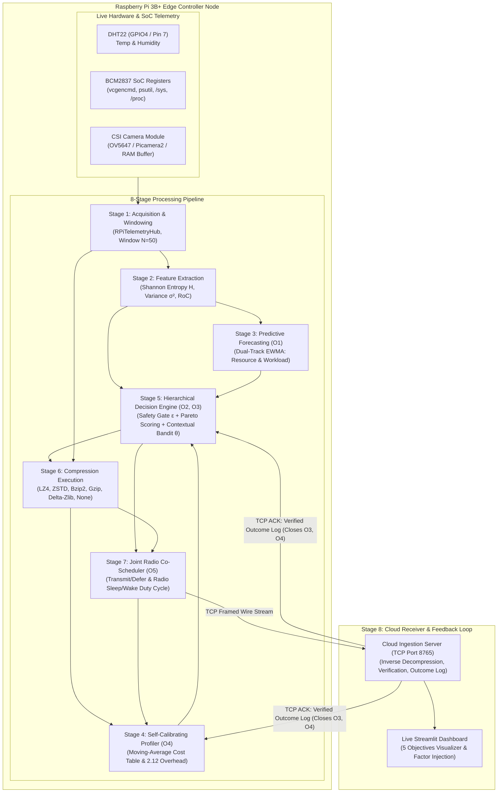

# Predictive Multi-Objective Compression Selection for IoT Edge Streams

[]()
[]()
[]()
[]()

An autonomous, closed-loop on-device embedded controller that performs context-aware compression and transmission scheduling for streaming IoT sensor data. Designed for resource-constrained edge hardware (**Raspberry Pi 3B+ / Broadcom BCM2837 SoC**) communicating with a cloud receiver.

Framed as a **hardware-grounded controller pipeline**:  
`sensing ➔ forecasting ➔ deciding ➔ compressing ➔ radio scheduling ➔ transmission ➔ cloud feedback`

---

## 1. System Architecture & The 5 Core Objectives



### The Five Architectural Objectives

* **O1. Predictive Multi-Signal Forecasting (Stage 3):**  
  Forecasts near-future conditions along two tracks using EWMA ($\hat{x}_{t+1} = \alpha \cdot x_t + (1 - \alpha) \cdot \hat{x}_t$):
  - *Resource Track:* Forecasts SoC CPU load, SoC temperature, available network bandwidth, and battery/power reserve.
  - *Workload Track:* Forecasts the upcoming trend in data entropy $H$ and compressibility.
* **O2. Hierarchical Decision Engine (Stage 5):**  
  Combines rule-based safety gating with multi-objective Pareto scoring:
  - *Safety Gate:* Rejects any candidate configuration whose calibrated expected error exceeds threshold $\epsilon$ ($\text{Error} \le \epsilon$, with strict $\epsilon=0.0$ for safety-critical telemetry).
  - *Pareto Utility:* $\text{Score} = w_1 \cdot \text{Ratio}_{\text{norm}} - w_2 \cdot \text{Energy}_{\text{norm}} - w_3 \cdot \text{Latency}_{\text{norm}}$, shifting weights under thermal, battery, and bandwidth stress.
* **O3. Online Workload-Adaptive Learning Policy (Stage 5):**  
  Selection policy updated incrementally after every window from real Stage 8 outcome feedback via a contextual bandit:
  $$\theta \leftarrow \theta + \eta \cdot (\text{Actual Score} - \text{Predicted Score}) \cdot \text{context}$$
* **O4. Hardware-Grounded Self-Calibrating Profiler (Stage 4):**  
  Maintains a live-updated table of real, measured costs per configuration conditioned on context:
  $$\bar{C}_k \leftarrow \bar{C}_k + \beta \cdot (C_{\text{measured}} - \bar{C}_k)$$
  Refreshed using real on-device measurements: energy drawn, CPU load, and radio wake-time.
* **O5. Joint Compression–Radio Duty-Cycle Co-Scheduling (Stage 7):**  
  Couples the transmit/defer decision with the radio transceiver's sleep/wake schedule. When deferring, the radio sleeps for extended intervals, saving transceiver energy beyond compression alone.

---

## 2. Pipeline Stages Breakdown

| Stage | Name | Objective | Key Functionality & Modules |
| :--- | :--- | :---: | :--- |
| **Stage 1** | **Data Acquisition & Windowing** | — | Polls live sensor and SoC telemetry through `RPiTelemetryHub` and batches samples into discrete `Window` objects (`N=50` or `T_max=5.0s`), tagged with `data_type` and `criticality`. |
| **Stage 2** | **Feature Extraction** | — | Computes Shannon Entropy ($H = -\sum p_i \log_2 p_i$), sample variance ($\sigma^2$), and Rate of Change ($\text{RoC}$) using pure Python fast-math. |
| **Stage 3** | **Predictive Forecasting Module** | **O1** | Dual-track EWMA forecasting ($\alpha=0.3, \beta=0.2$) for resource state (CPU, temp, bandwidth, battery) and future sensing workload trend (entropy trajectory). |
| **Stage 4** | **Self-Calibrating Hardware Profiler** | **O4** | Maintains live moving-average calibration cost table $\bar{C}_k$ ($\beta=0.15$). Also tracks Section 2.12 controller computational/RAM overhead and decision latency. |
| **Stage 5** | **Hierarchical Decision Engine** | **O2, O3** | Solves 3-layer hierarchy: (a) Rule-based safety gate ($\text{Error} \le \epsilon$), (b) Dynamic Pareto utility scoring, (c) Online contextual bandit policy update ($\eta=0.05$). |
| **Stage 6** | **Compression Execution** | — | Executes selected codec (LZ4, Zstandard, Bzip2, Gzip, Delta-Zlib, None), measuring execution latency, CPU load, energy proxy, and self-measured local reconstruction error. |
| **Stage 7** | **Radio Duty-Cycle & Transmission** | **O5** | Jointly duty-cycles radio transceiver sleep/wake schedule with transmission/deferral decisions. Buffers to RAM FIFO queue during dropouts; flushes upon recovery. |
| **Stage 8** | **Cloud Receiver & Feedback Loop** | **Closes O3, O4** | Decompresses packets over TCP socket (Port 8765), verifies error ($\epsilon=0.0$), commits to `logs/outcomes.csv`, and sends verified Outcome Log back in TCP ACK to close online learning. |

---

## 3. Hardware Wiring & Physical Specifications

### Target Platform: Raspberry Pi 3B+
- **SoC:** Broadcom BCM2837 (Quad-Core ARM Cortex-A53 @ 1.4 GHz)
- **RAM:** 1 GB LPDDR2 SDRAM
- **OS:** Raspberry Pi OS Lite / Desktop (32-bit `armv7l` or 64-bit `aarch64`)

```text
Raspberry Pi 3B+ 40-Pin Header:
┌────────────────────────────────────────────────────────┐
│  (3.3V)  [Pin 1] ────→ DHT22 VCC (Pin 1)               │
│  (GPIO4) [Pin 7] ────→ DHT22 DATA (Pin 2)              │
│                        [+ 10kΩ pull-up resistor to 3.3V]│
│  (GND)   [Pin 9] ────→ DHT22 GND (Pin 4)               │
└────────────────────────────────────────────────────────┘

CSI Camera Module (5MP OV5647 / 8MP IMX219):
┌────────────────────────────────────────────────────────┐
│  15-Pin CSI Ribbon Cable → Raspberry Pi CSI Port       │
│  (Blue tape facing Ethernet/USB ports)                 │
└────────────────────────────────────────────────────────┘
```

---

## 4. Quickstart & Installation

### A. On Raspberry Pi 3B+ (Edge Node)

```bash
# 1. Clone repository
git clone https://github.com/jain05vaibhav/Predictive-Multi-Objective-Compression-Selection.git
cd Predictive-Multi-Objective-Compression-Selection

# 2. Run automated hardware setup script
chmod +x scripts/*.sh network_sim/*.sh
./scripts/setup_raspberry_pi.sh

# 3. Launch the autonomous closed-loop edge controller
./scripts/run_edge.sh <LAPTOP_OR_CLOUD_IP>
```

### B. On PC / Laptop (Cloud Receiver & Visual Dashboard)

```bash
# 1. Create venv and install dashboard dependencies
python3 -m venv .venv
source .venv/bin/activate  # On Windows: .venv\Scripts\activate
pip install -r requirements-dashboard.txt

# 2. Terminal 1: Start Stage 8 Cloud Ingestion Server (TCP Port 8765)
./scripts/run_cloud.sh
# Alternatively: python -m cloud.receiver

# 3. Terminal 2: Launch Live Streamlit Dashboard
./scripts/run_dashboard.sh
# Alternatively: streamlit run dashboard/app.py
```

---

## 5. Automated Verification Suite (66 Unit Tests)

Run the full automated test suite covering all 8 stages, hardware drivers, closed-loop feedback, radio duty-cycle scheduler, and contextual bandit learning:

```bash
python -m unittest discover tests -v
```

### Test Suite Matrix:
* `test_stage1.py`: Dynamic window batching, serializations, and timeout behavior.
* `test_stage2.py`: Shannon entropy ($H$), variance, and rate-of-change.
* `test_stage3.py`: Dual-track EWMA forecasting (resource & workload), thermal/throttling risk.
* `test_stage4.py` & `test_stage4_profiler.py`: Moving-average calibration updates $\bar{C}_k$, context bucketing, and Section 2.12 controller overhead tracking.
* `test_stage5.py` & `test_stage5_decision_bandit.py`: Rule-based safety gate ($\text{Error} \le \epsilon$), Pareto utility scoring, and contextual bandit online learning ($\theta$).
* `test_stage6.py` & `test_stage7_radio.py`: Real codec execution, local error calculation, joint radio sleep/wake duty-cycling, and FIFO backlog recovery.
* `test_stage7.py` (Stage 8 Cloud Receiver): Decompression verification, lossless integrity, and OutcomeStore aggregations.
* `test_closed_loop_feedback.py`: End-to-end multi-stage networking test verifying Stage 8 Outcome Log closes the learning loop back to Stages 4 and 5.
* `test_network_shaper.py`: Network simulation profile validation (4G, 3G, 2G, satellite, congestion).
* `test_camera_reader.py`, `test_dht22_reader.py`, `test_rpi_system_reader.py`: Hardware driver abstractions.

---

## 6. Network Variability Emulation (`network_sim/`)

Test edge adaptability under varying wireless conditions using the Linux traffic-control tool:

```bash
# Apply 4G LTE Profile
sudo ./network_sim/netem_profiles.sh 4g_lte wlan0

# Apply 2G Edge Constrained Profile (150 kbps, 250ms latency)
sudo ./network_sim/netem_profiles.sh 2g_edge wlan0

# Apply Critical Congestion Profile (50 kbps, 450ms latency, 8% loss)
sudo ./network_sim/netem_profiles.sh congested wlan0

# Restore Unthrottled Baseline
sudo ./network_sim/netem_profiles.sh normal wlan0
```

---

## 7. Section 2.12 Controller Overhead Reporting

As required by the architecture specification, the system reports the controller's own computational and memory overhead:
- **Controller CPU Time:** Time spent executing Stages 2–5 per window ($\approx 0.05 - 0.90\text{ ms}$).
- **Controller RAM Usage:** Process Resident Set Size (RSS $\approx 80 - 85\text{ MB}$).
- **Worst-Case Decision Latency:** Max observed Stage 5 decision calculation latency ($\approx 0.53\text{ ms}$).
- Persisted automatically to `logs/controller_overhead.csv` and visualized live in the Streamlit Dashboard.
