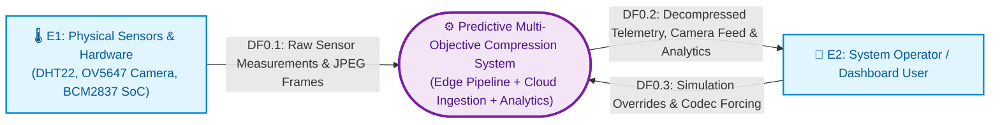
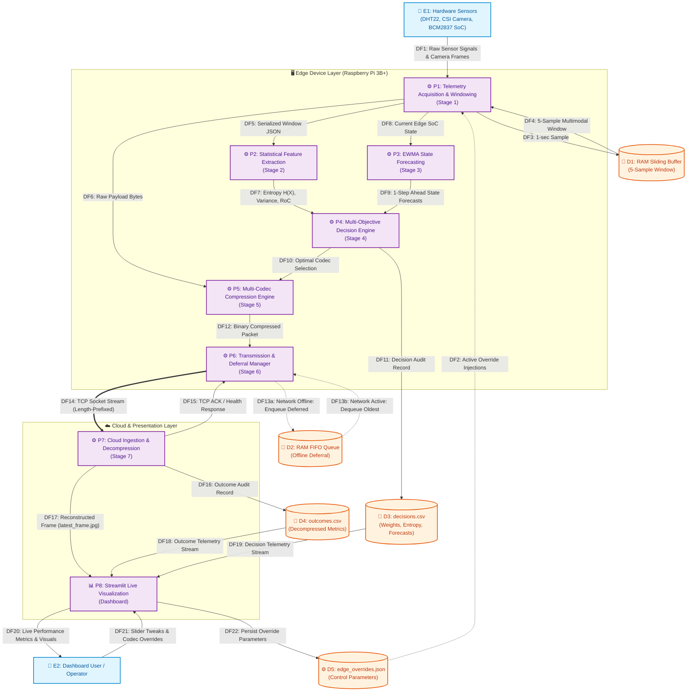
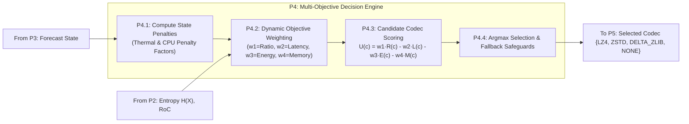
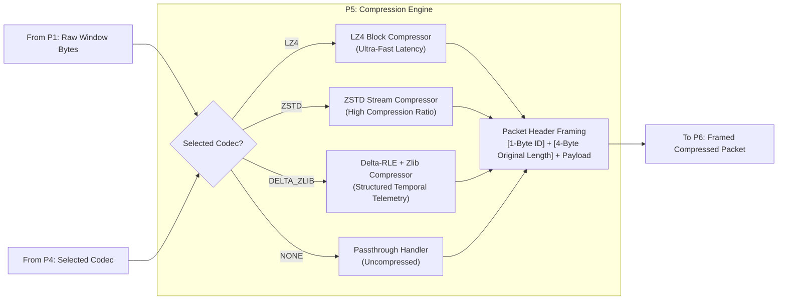

# Software Engineering Data Flow Diagram (DFD)
## Predictive Multi-Objective Compression Selection System

---

## 1. Overview & Software Engineering Standards

This document presents the **Data Flow Diagram (DFD)** for the **Predictive Multi-Objective Compression Selection Pipeline** spanning the **Raspberry Pi 3B+ Edge Device**, the **TCP Network Channel**, the **Cloud Ingestion Service**, and the **Interactive Streamlit Dashboard**.

### Notation Standard: Yourdon & DeMarco
- **External Entities ($E_n$)**: External actors, physical environments, or hardware sources outside software boundaries.
- **Processes ($P_n$)**: Software operations transforming input data streams into output data streams.
- **Data Stores ($D_n$)**: Volatile or persistent storage locations (RAM sliding buffers, FIFO queues, CSV outcome ledgers, JSON configs).
- **Data Flows (Solid/Dashed Directed Arrows)**: Formally typed data flowing between entities, processes, and stores.

---

## 2. Level-0: Context Data Flow Diagram

The Level-0 Context Diagram establishes the highest-level operational boundary between external actors and the system.

---

## 3. Level-1: Detailed Data Flow Diagram

The Level-1 DFD decomposes the system into its primary functional processes across the Edge and Cloud layers, detailing storage interactions, queueing resilience, and the closed-loop control channel.

---

## 4. Level-2: Subsystem Decomposition

### 4.1 Decision Subsystem (P4 Internal Flow)

### 4.2 Compression Subsystem (P5 Internal Flow)

---

## 5. Comprehensive Data Flow Dictionary

| Flow ID | Flow Name | Source | Destination | Data Structure / Content | Description |
| :--- | :--- | :--- | :--- | :--- | :--- |
| **DF1** | Raw Sensor Signals | $E_1$ | $P_1$ | `float temp_c`, `float hum_pct`, `bytes jpeg`, `float cpu_pct` | Real-time physical GPIO & camera inputs. |
| **DF2** | Override Injections | $D_5$ | $P_1$ | `{"cpu_temperature": 78.5, "force_codec": "LZ4"}` | Live cloud-injected control parameters. |
| **DF3** | 1-sec Sample | $P_1$ | $D_1$ | `TelemetrySample` schema (JSON object) | Periodic timestamped sensor recording. |
| **DF4** | Multimodal Window | $D_1$ | $P_1$ | Array of 5 `TelemetrySample` + 1 Base64 Frame | Batch aggregation for block compression. |
| **DF5** | Serialized Window | $P_1$ | $P_2$ | Canonical JSON String (`str`) | Formatted payload for entropy/variance calculation. |
| **DF6** | Raw Payload Bytes | $P_1$ | $P_5$ | UTF-8 Encoded Byte Array (`bytes`) | Input payload to be compressed. |
| **DF7** | Statistical Features | $P_2$ | $P_4$ | `{"entropy": float, "variance": float, "roc": float}` | Information content and compressibility indicators. |
| **DF8** | Current State | $P_1$ | $P_3$ | `{"cpu_load": float, "temp_c": float, "bw_kbps": float}` | Current system telemetry for time-series memory. |
| **DF9** | State Forecasts | $P_3$ | $P_4$ | `{"pred_cpu": float, "pred_temp": float, "pred_bw": float}` | EWMA & Holt's trend 1-step ahead state projections. |
| **DF10**| Selected Codec ID | $P_4$ | $P_5$ | `CodecID (enum: 0=NONE, 1=LZ4, 2=ZSTD, 3=DELTA_ZLIB)` | Optimal algorithm for the current window. |
| **DF11**| Decision Audit | $P_4$ | $D_3$ | CSV Row: `[ts, chosen_codec, w1..w4, entropy, ...]` | Log entry recording optimization decisions. |
| **DF12**| Compressed Packet | $P_5$ | $P_6$ | Binary Header (5 bytes) + Compressed Byte Stream | Packaged compressed window. |
| **DF13a**| Defer Packet | $P_6$ | $D_2$ | In-Memory `queue.Queue` of Binary Packets | Offline backup buffer during connection failures. |
| **DF13b**| Dequeue Deferred | $D_2$ | $P_6$ | In-Memory `queue.Queue` elements | FIFO drain sequence when network recovers. |
| **DF14**| TCP Socket Stream | $P_6$ | $P_7$ | `[4-Byte Big-Endian Length Prefixed][Payload Bytes]` | Framed network socket stream over TCP. |
| **DF15**| TCP ACK / Health | $P_7$ | $P_6$ | JSON Response: `{"status": "ACK", "lossless": true}` | End-to-end receipt and integrity confirmation. |
| **DF16**| Outcome Audit | $P_7$ | $D_4$ | CSV Row: `[ts, codec, orig_size, comp_size, ratio, latency]` | Ground-truth verification log. |
| **DF17**| Latest Frame | $P_7$ | $P_8$ | JPEG File: `latest_frame.jpg` | Decompressed camera image for live dashboard. |
| **DF18**| Outcome Stream | $D_4$ | $P_8$ | Pandas DataFrame | Real-time performance time-series. |
| **DF19**| Decision Stream | $D_3$ | $P_8$ | Pandas DataFrame | Real-time objective weights and forecast tracking. |
| **DF20**| Visual Metrics | $P_8$ | $E_2$ | HTML5 / Canvas / Streamlit Graphs | Interactive UI for human operator. |
| **DF21**| Slider Tweaks | $E_2$ | $P_8$ | UI Event / Form Submission | Human-in-the-loop parameter adjustments. |
| **DF22**| Persist Override | $P_8$ | $D_5$ | JSON File: `logs/edge_overrides.json` | Persistent configuration sync. |

---

## 6. Software Engineering Quality Attributes & Architecture Principles

### 1. High Cohesion & Single Responsibility Principle (SRP)
- Each module performs exactly one bounded task.
- `stage1` acquires; `stage2` computes math; `stage3` forecasts; `stage4` makes multi-objective decisions; `stage5` transforms bytes; `stage6` transmits; `stage7` verifies.

### 2. Loose Coupling & Contract-Driven Design
- Stages interact strictly via strongly-typed schemas (`TelemetrySample`, canonical JSON strings, standardized binary packet framing).
- The network interface uses explicit 4-byte length prefixing to prevent TCP fragmentation issues.

### 3. Fault Tolerance & Zero Data Loss
- The transmission stage ($P_6$) encapsulates a non-blocking FIFO queue ($D_2$) allowing uninterrupted sensor operation even if the network fails completely.
- When connection re-establishes, backlogged packets are automatically drained and delivered in chronological order.

### 4. Zero-Loss Verification ($\varepsilon = 0.0\%$)
- Stage 7 enforces a strict lossless mathematical identity:
$$\text{DecodedData} \equiv \text{OriginalData} \implies \varepsilon = 0.0\%$$
- Any hash or byte discrepancy triggers an immediate anomaly flag.
